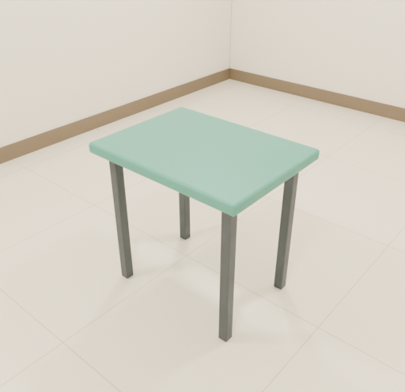

# CADtour — CAD 平面图与诊室三维设计

本地开源试用版，2026-10-19。代码沿用原项目 MIT 许可及署名。



在平面图中编辑墙、门、玻璃、地面和家具，切换三维预览，使用本机 Blender Cycles 生成效果图。
支持导入自己的 BLEND、FBX＋贴图、GLB 模型，无需修改代码。

这是功能完整的本地版，不是多人云端服务。模型质量、CAD 识别与输出尺寸仍需设计师核对，不能直接替代施工图审查。

## Windows 快速开始

1. 下载并**完整解压**本项目到可写文件夹，例如 `Documents/CADtour`。不要直接在压缩包内运行。
2. 安装 [Python](https://www.python.org/downloads/) 3.10 或更新版本，安装时勾选 **Add python.exe to PATH**。
3. 安装 [Blender](https://www.blender.org/download/)。本版本实际验证环境为 Windows、Python 3.13、Blender 5.2；其他 Blender 版本尚未逐一验证。
4. 双击 **`Start-CADtour.cmd`**。浏览器打开 `http://127.0.0.1:4180`，运行时保持启动窗口开启。
5. 关闭前导出方案 JSON；在启动窗口按 `Ctrl+C` 停止服务，渲染进行中请先在网页取消。

仅编辑平面图和查看三维可以不安装 Blender。**素材转换和 Cycles 渲染需要 Blender，立体文字需要 Windows 本地字体。** 不需要安装 BlenderKit，也不需要配置 Blender MCP。

无需 `pip install`，网页依赖已随包提供，已解压的项目可离线运行。不要直接双击 `index.html`，也不要用 `python -m http.server` 替代配套服务。

手动启动和检查：

```powershell
python launch.py --check
python launch.py
# 端口冲突时：
python launch.py --port 4181
# 不自动打开浏览器：
python launch.py --no-browser
```

如果 Blender 安装在特殊位置，可在 PowerShell 中设置后启动：

```powershell
$env:CADTOUR_BLENDER = 'D:\Tools\Blender\blender.exe'
python launch.py
```

## 第一次体验

- 打开后有内置示例户型和程序生成的家具，可直接切换 2D／3D。
- `examples/demo-office.dxf` 是用代码生成的虚构平面图，可用于测试 CAD 导入。先导出当前方案再切换图纸。
- 左侧 **导入素材 · 示例** 中的“示例边桌（MIT）”提供 GLB 和原生 BLEND，可测试摆放、尺寸调整和 Cycles 原生模型替换。
- 下载者可用“导入模型素材”上传自己的 BLEND、GLB 或 FBX＋贴图 ZIP，经预览、尺寸校正后加入素材库。
- 选中墙面可使用随包的 ambientCG Wallpaper001B（CC0）材质。

**第三方精细模型未随此开源包分发。** 牙椅、Hertford 椅、接待台、iMac、绿植、冷杉、U 形桌、222 组合的原始文件未包含；对应的缺失模型卡片已从默认库隐藏。功能没有被关闭，可以导入自己有权使用的模型。旧方案若引用这些文件，需要先补齐原素材或手动重新放置；导入会生成新模型 ID，不会自动替换旧 ID。

## 功能范围

- DXF 图层映射与户型识别、房间信息、测量、二维与三维同步。
- 墙、玻璃隔断、门的添加与拆改，分段拆除、撤销／重做。
- 地面分区、颜色与材质，墙面材质、踢脚线高度与颜色。
- 家具放置、旋转、尺寸、离地高度，以及现有台面吸附支持。
- 墙面图片、文字、挂墙模型及 Windows 字体生成的立体文字。
- 本地模型导入、预览、尺寸校正、原生 BLEND 与网页 GLB 配对。
- 相机漫游、日夜照明、Cycles 渲染、下载 PNG 与完整渲染场景。
- 浏览器自动保存，方案 JSON 导出／导入。

**当前边界：** DWG 请先转 DXF；独立墙地材质 ZIP 自助导入尚未实现；复杂 FBX 材质可能需要修复；超重模型可能影响交互。所有价格是示例估算，不能直接作为报价。

## 保存、备份与模型文件

方案自动保存在**当前浏览器、当前地址及端口**的本地存储中；换浏览器、换端口或清除浏览器数据后不会自动出现。

- 经常通过“文件”菜单导出方案 JSON。
- JSON 保存布局和素材引用，**不包含模型二进制文件**。
- 跨电脑迁移时，同时备份方案 JSON 和整个 `assets/models/`；若添加了自定义材质，也备份相关材质文件。
- 内置示例清单在 `assets/models/catalog.json`；新增模型登记在被 Git 忽略的 `catalog.local.json`，不会修改公开示例清单。
- `.renders/` 是渲染历史；`.asset-imports/` 是导入任务目录。确认不再需要、任务已停止后可自行清理，先备份需要的 PNG／BLEND。

## 已知原包问题

原发布包未包含“快速预览”输出图片所需的部分后处理模块，因此该输出路径可能报错。
本次精简没有删除这些模块（原包已缺失）；可选择 Blender Cycles 渲染。三维编辑预览是另一条路径。

## 使用者精简版

此包保留启动、平面编辑、三维预览、模型导入、Cycles 渲染、示例素材和许可文件。
测试脚本、开发验证记录、素材生成脚本和发布打包工具未包含。无需安装 Node 或测试依赖。
已提供的示例模型和示例图纸可直接使用，不需要重新生成。

更多信息：[渲染说明](RENDERING.md) · [素材与依赖许可](THIRD_PARTY_NOTICES.md) · [英文简介](README.en.md)。
